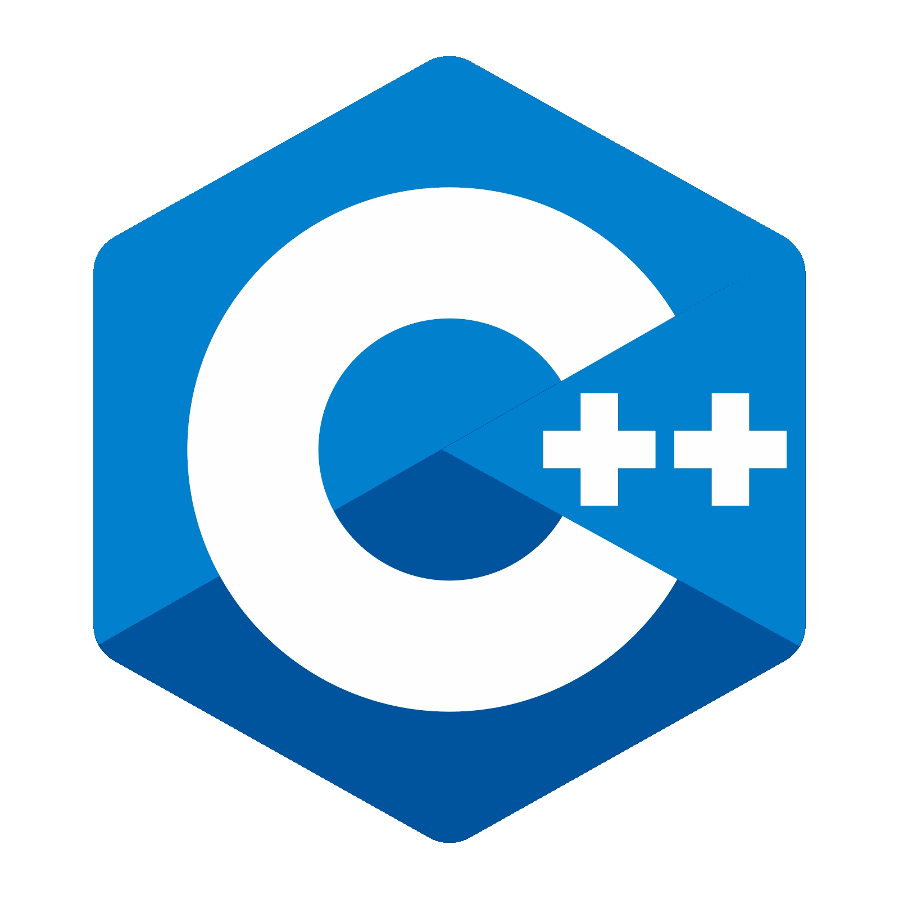

<h1 align="center" id="macropower-title">:wave: Hello there! I'm Bruno!</h1>

<!--
**Bruno-Mafra/Bruno-Mafra** is a ✨ _special_ ✨ repository because its `README.md` (this file) appears on your GitHub profile.
-->

   &nbsp;
  
   - 👦 27 years old
   
   - 🌇 Living in São Bernardo do Campo, São Paulo
  
   - 🔭 Working as a Software Engineer at @Descomplica
  
   - 🌱 B.Sc. in Computer Science from UFABC
      
   - 💬 Ask me about games, LOL, series and programming
  
   - 📫 You can reach me through LinkedIn
  
   - 😄 Pronouns: he/him
  
   
  
 <h2 id="techs" align="center">Favorite Tech</h2>
 
 Tools, languages, and other stuff that I'm currently learning and enjoying to work with. 

  <table>
    <tr>
      <td align="center" width="96">
        
         Javascript
      </td>
      <td align="center" width="96">
        
         React
      </td>
      <td align="center" width="96">
        
         Typescript
      </td>
      <td align="center" width="96">
        
         HTML5
      </td>
      <td align="center" width="96">
        
         CSS3
      </td>
      <td align="center" width="96">
        
         PostgreSQL
      </td>
      <td align="center" width="96">
        
         Jest
      </td>
      <td align="center" width="96">
        
         Python
      </td>
      <td align="center" width="96">
        
         C/C++
      </td>
    </tr>
  </table>

 <h2 align="center">Github Stats</h2>
 
 Same old stats that everybody put in their Github profiles 😅 

  <a href="https://github.com/stats-organization/github-stats-extended">
    <picture>
      <source media="(prefers-color-scheme: dark)" srcset="https://github-stats-extended.vercel.app/api?username=Bruno-Mafra&show_icons=true&theme=dark">
      <source media="(prefers-color-scheme: light)" srcset="https://github-stats-extended.vercel.app/api?username=Bruno-Mafra&show_icons=true&theme=default">
      
    </picture>
  </a>
  <a href="https://github.com/stats-organization/github-stats-extended">
    <picture>
      <source media="(prefers-color-scheme: dark)" srcset="https://github-stats-extended.vercel.app/api/top-langs/?username=Bruno-Mafra&langs_count=8&layout=compact&theme=dark&hide=Jupyter%20Notebook">
      <source media="(prefers-color-scheme: light)" srcset="https://github-stats-extended.vercel.app/api/top-langs/?username=Bruno-Mafra&langs_count=8&layout=compact&theme=default&hide=Jupyter%20Notebook">
      
    </picture>
  </a>

  

   <picture>
     <source media="(prefers-color-scheme: dark)" srcset="https://github.com/Bruno-Mafra/Bruno-Mafra/blob/output/github-contribution-grid-snake-dark.svg" />
     <source media="(prefers-color-scheme: light)" srcset="https://github.com/Bruno-Mafra/Bruno-Mafra/blob/output/github-contribution-grid-snake.svg" />
     
   </picture>

<h2 align="center" id="techs">Contact me!</h2>
  

    
  

